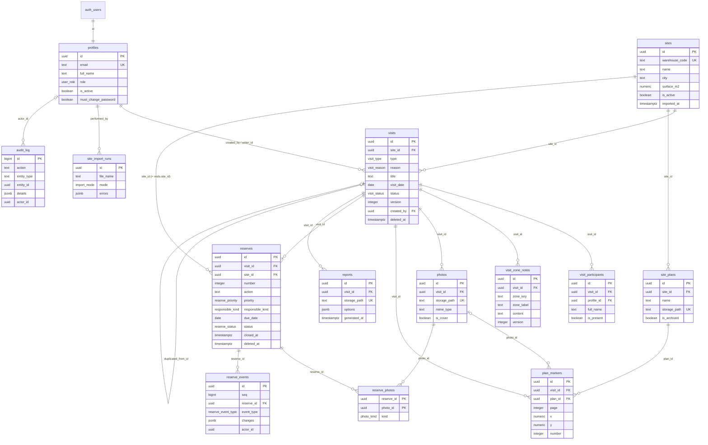

# Modèle de données RONDE (étape 2)

Schéma Postgres livré par les migrations de `supabase/migrations/`. Les règles d'accès sont
appliquées dans la base (RLS), les valeurs dérivées sont calculées à la lecture et la
traçabilité repose sur des tables en ajout seul.

## Schéma

## Rôle de chaque table

| Table                | Rôle                                                 | Particularités                                                                                                                              |
| -------------------- | ---------------------------------------------------- | ------------------------------------------------------------------------------------------------------------------------------------------- |
| `profiles`           | Un profil applicatif par utilisateur Supabase Auth   | Rôle `rt` / `direction` / `admin` ; `is_active` ; jamais supprimé. Rôle, activation, email et état du mot de passe réservés au service.     |
| `sites`              | Référentiel des entrepôts importé de VIGIE           | Lecture seule pour les utilisateurs ; un site disparu est désactivé, jamais supprimé ; index trigram sur nom, ville et code.                |
| `site_import_runs`   | Journal des imports VIGIE (simulation / application) | Écrit par le service, lu par l'admin.                                                                                                       |
| `visits`             | Visite de site                                       | Site obligatoire, actif à la création et immuable ; `status` et suppression logique uniquement par RPC ; `version` incrémentée par trigger. |
| `visit_participants` | Participants internes (profil) ou externes           | Un participant lié à son profil peut modifier la visite.                                                                                    |
| `visit_zone_notes`   | Notes par zone                                       | Clé de zone de la trame ou `custom-…` ; unique par visite et zone.                                                                          |
| `photos`             | Métadonnées des photos (bucket `visit-photos`)       | Au plus une photo de garde par visite.                                                                                                      |
| `site_plans`         | Plans rattachés au **site**                          | Réutilisés de visite en visite ; archivés, jamais supprimés. `pending` jusqu'à la confirmation de l'import (migration 15).                  |
| `site_plan_pages`    | Pages d'un plan converties en images                 | Image d'affichage 3 500 px et miniature 400 px par page ; figées une fois le plan prêt (migration 15).                                      |
| `plan_markers`       | Repères posés sur un plan pendant une visite         | Coordonnées relatives 0..1 ; numéro unique par visite et plan.                                                                              |
| `reserves`           | Réserves relevées en visite                          | Numérotées par site par trigger ; `site_id` rempli et vérifié ; `closed_at` géré ; suppression logique par RPC.                             |
| `reserve_photos`     | Lien réserve ↔ photo                                 | `defect` ou `proof`.                                                                                                                        |
| `reserve_events`     | Historique des réserves                              | **Ajout seul**, alimenté par trigger, `changes` = champs modifiés (ancienne / nouvelle valeur), `seq` pour l'ordre.                         |
| `reports`            | Rapports PDF générés (bucket `reports`)              | Jamais modifiés ; supprimés uniquement avec la visite (cascade).                                                                            |
| `audit_log`          | Journal d'audit                                      | **Ajout seul**, alimenté par trigger et par les RPC ; `actor_id` null pour le système.                                                      |

## Valeurs dérivées (jamais stockées)

| Valeur                 | Où                               | Calcul                                                                                                                                                                                                                                                 |
| ---------------------- | -------------------------------- | ------------------------------------------------------------------------------------------------------------------------------------------------------------------------------------------------------------------------------------------------------ |
| Retard d'une réserve   | `reserves_with_state.is_overdue` | `due_date < date du jour en Europe/Paris` et `status <> 'done'` (`private.is_reserve_overdue`).                                                                                                                                                        |
| Code affiché           | `reserves_with_state.code`       | `'R-'                                                                                                                                                                                                                                                  |     | lpad(number, 2, '0')` → « R-07 ». |
| Compteurs d'une visite | `visit_summaries`                | Réserves ouvertes (`status <> 'done'`), en retard, levées ; nombre de photos ; date du dernier rapport ; zones (`zones_count`) et zones renseignées (`filled_zones_count`, contenu non vide une fois les espaces retirés). Visites supprimées exclues. |

Les deux vues sont en `security_invoker` : la RLS des tables s'applique à l'appelant.

## Fonctions

| Fonction                                                     | Rôle                                                                                                              |
| ------------------------------------------------------------ | ----------------------------------------------------------------------------------------------------------------- |
| `private.current_role()`                                     | Rôle du profil actif de `auth.uid()`, sinon `null`.                                                               |
| `private.is_active_user()`, `is_rt_or_admin()`, `is_admin()` | Prédicats de rôle.                                                                                                |
| `private.can_read_visit(id)`                                 | Utilisateur actif ; visite non supprimée (l'admin voit les supprimées).                                           |
| `private.can_edit_visit(id)`                                 | RT ou admin actif ; visite non supprimée et en cours ; créateur, rédacteur ou participant lié ; l'admin toujours. |
| `private.can_manage_visit(id)`                               | Créateur, rédacteur ou admin (réouverture, suppression).                                                          |
| `public.complete_visit(id)`                                  | Clôture, si `can_edit_visit`. Tracée `visit.completed`.                                                           |
| `public.reopen_visit(id)`                                    | Réouverture, si `can_manage_visit` et visite terminée. Tracée `visit.reopened`.                                   |
| `public.soft_delete_visit(id)`                               | Suppression logique, si `can_manage_visit`. Tracée `visit.deleted`.                                               |
| `public.soft_delete_reserve(id)`                             | Suppression logique d'une réserve, si sa visite est modifiable. Tracée par trigger.                               |

Toutes les fonctions `security definer` fixent `search_path = ''` et qualifient les noms.

## Matrice RLS (telle qu'implémentée et testée)

Acteurs : `anon` ; `rt` créateur (Alice), `rt` participant (Bruno), `rt` non impliqué (Emma) ;
`direction` (Claire) ; `admin` (David) ; `inactif`. `service_role` contourne la RLS (serveur
uniquement). Un utilisateur inactif ou sans profil ne voit rien ; `anon` n'a aucun privilège.

| Table                                                              | Lecture                                                                          | Insertion                                               | Mise à jour                                                                             | Suppression                                |
| ------------------------------------------------------------------ | -------------------------------------------------------------------------------- | ------------------------------------------------------- | --------------------------------------------------------------------------------------- | ------------------------------------------ |
| `profiles`                                                         | actifs : `id`, `full_name`, `role`, `is_active` de tous (privilèges de colonnes) | aucune (service)                                        | soi-même, `full_name` seulement ; trigger : rôle, activation, email réservés au service | aucune                                     |
| `sites`                                                            | actifs                                                                           | service                                                 | service                                                                                 | aucune                                     |
| `site_import_runs`                                                 | admin                                                                            | service                                                 | service                                                                                 | aucune                                     |
| `visits`                                                           | actifs hors supprimées ; admin : toutes                                          | rt / admin, `created_by = auth.uid()`, site actif       | `can_edit_visit` ; `status`, `completed_*`, `deleted_*` par RPC seulement               | aucune (logique par RPC)                   |
| `visit_participants`, `visit_zone_notes`, `photos`, `plan_markers` | si la visite est lisible                                                         | `can_edit_visit`                                        | `can_edit_visit`                                                                        | `can_edit_visit`                           |
| `reserve_photos`                                                   | si la visite de la réserve est lisible                                           | `can_edit_visit`                                        | `can_edit_visit`                                                                        | `can_edit_visit`                           |
| `site_plans`                                                       | actifs                                                                           | rt / admin                                              | rt / admin (archivage)                                                                  | aucune                                     |
| `reserves`                                                         | actifs hors supprimées ; admin : toutes                                          | `can_edit_visit`                                        | `can_edit_visit`                                                                        | aucune (logique par `soft_delete_reserve`) |
| `reserve_events`                                                   | actifs, si la visite est lisible                                                 | aucune (trigger)                                        | refusée pour tous                                                                       | refusée pour tous                          |
| `audit_log`                                                        | admin                                                                            | aucune (trigger / RPC)                                  | refusée pour tous                                                                       | refusée pour tous                          |
| `reports`                                                          | actifs, si la visite est lisible                                                 | rt, admin **et direction**, `generated_by = auth.uid()` | aucune                                                                                  | aucune                                     |

Note : « refusée pour tous » inclut `service_role` et `postgres` (triggers `before update`,
`before delete` et `before truncate`). L'insertion directe est également refusée : seules les
fonctions internes, qui posent le marqueur `ronde.internal_write`, peuvent écrire.

## Stockage

Buckets **privés** créés par migration ; aucun accès public, URL signées à partir de l'étape 7.

| Bucket         | Chemin                                                                    | Limite | Types           | Lecture                          | Écriture                                                                    |
| -------------- | ------------------------------------------------------------------------- | ------ | --------------- | -------------------------------- | --------------------------------------------------------------------------- |
| `visit-photos` | `{visit_id}/{photo_id}.{ext}`                                             | 15 Mo  | JPEG, PNG, WebP | visite lisible                   | visite modifiable (insert, update, delete)                                  |
| `site-plans`   | `{site_id}/{plan_id}/original.{ext}`, `p{n}.{png\|jpg}`, `p{n}_thumb.jpg` | 50 Mo  | PDF, PNG, JPEG  | utilisateur actif, site existant | rt / admin (insert) ; pas de suppression                                    |
| `reports`      | `{visit_id}/{report_id}.pdf`                                              | 50 Mo  | PDF             | visite lisible                   | visite lisible (insert, direction comprise) ; ni mise à jour ni suppression |

Le premier segment du chemin est l'identifiant de la visite ou du site
(`private.storage_root_id`).

## Recherche des sites (migration 10)

L'extension `unaccent` (schéma `extensions`) et la fonction `immutable`
`private.search_text(text)` (minuscules, sans accents) normalisent le texte de recherche.
`private.site_search_text(name, warehouse_code, city)` concatène nom, code et ville ; un index
trigram GIN porte sur cette expression. La recherche combine `ILIKE` (jokers échappés) et la
similarité trigram, classe le code exact en premier, puis les correspondances `ILIKE`, puis la
similarité, et exclut les sites inactifs par défaut.

`site_import_runs` reçoit `file_sha256` (empreinte du fichier, jamais conservé) et `options`.

## Comptes jamais supprimés (migration 9)

`audit_log.actor_id`, `reserve_events.actor_id`, `reports.generated_by` et
`site_import_runs.performed_by` référencent `profiles` avec `on delete restrict`, et le trigger
`profiles_never_deleted` refuse toute suppression de profil (y compris en cascade depuis
`auth.users`) avec le message « RONDE: un compte ne se supprime pas, il se désactive (historique
attribué) ».

## Notes par zone et versions (migration 12)

Deux niveaux de concurrence optimiste :

| Niveau             | Colonne                    | Incrémentée quand                                                                                    | Trigger                                                                                                                    |
| ------------------ | -------------------------- | ---------------------------------------------------------------------------------------------------- | -------------------------------------------------------------------------------------------------------------------------- |
| Note (contenu)     | `visit_zone_notes.version` | le **contenu** change (et seulement lui) ; `updated_by` et `updated_at` suivent le contenu           | `zone_notes_before_update` (ligne) ; `visit_id` et `zone_key` immuables                                                    |
| Visite (structure) | `visits.version`           | ajout ou retrait d'une zone, changement de libellé ou d'ordre ; **pas** sur un changement de contenu | `touch_parent_visit_{insert,delete,update}` (instruction, tables de transition : une seule incrémentation par instruction) |

Les participants gardent leur trigger par ligne de l'étape 5 (`touch_parent_visit`). Pour les
notes, le trigger est par instruction parce que l'insertion d'une trame (neuf zones) ou un
réordonnancement se font en une instruction et ne doivent compter qu'une fois.

## Pages de plans et repères contrôlés (migration 15)

- `site_plans.upload_status` (`pending` par défaut, `ready`) : un plan en attente n'est visible
  que de son auteur ; la politique `site_plans_select` est recréée en conséquence.
- **`site_plan_pages`** : une ligne par page (`page_number` ≥ 1, unique par plan), avec
  `image_path` et `thumb_path` uniques, `image_mime` (`image/png` ou `image/jpeg`), `width`,
  `height`, `size_bytes` > 0. `on delete cascade` depuis le plan. RLS : lecture avec le plan ;
  insertion, mise à jour et suppression par rt / admin **tant que le plan est `pending`**
  (`private.plan_is_pending`) ; une fois prêt, les pages sont figées.
- Trigger **`plan_markers_check`** (avant insertion et mise à jour) : la page existe dans
  `site_plan_pages`, la photo liée appartient à la même visite, le plan est rattaché au site de
  la visite ; à l'insertion, le plan doit être `ready` et non archivé.
- `audit_site_plans` : `site_plan.imported` quand le plan passe de `pending` à `ready` (plus à
  l'insertion de la ligne en attente), `site_plan.renamed`, `site_plan.archived`,
  `site_plan.unarchived`.
- `private.purge_stale_pending_plans(interval)` (service_role) : supprime les plans `pending`
  de plus de 24 h (pages en cascade) et renvoie les chemins de l'original et des pages.
- Numérotation des repères : plus grand numéro de `(visit_id, plan_id)` + 1 sous verrou
  consultatif, jamais réattribué (voir `docs/plans.md`).

## Réserves modifiables et placées sur le plan (migration 16)

- `reserves.version` (≥ 1) : incrémentée par `reserves_before_update` à chaque mise à jour
  (concurrence optimiste, comme `visits`) ; l'historique l'ignore.
- Responsable facultatif : `responsible_kind` devient nullable (« À désigner »). La contrainte
  `reserves_responsible_consistency` est écrite sans valeur NULL possible (`coalesce`) : aucun
  champ si le type est nul, un profil seul si interne, un nom non vide (entreprise et e-mail
  facultatifs) si externe.
- `plan_markers.reserve_id` (nullable, clé étrangère `on delete restrict`, index unique
  partiel) : au plus un repère par réserve. `plan_markers_check` vérifie à l'insertion ou au
  changement de réserve qu'elle appartient à la même visite et n'est pas supprimée.
  `soft_delete_reserve` supprime le repère de la réserve dans la même transaction.
- Trigger `reserve_photos_check` : la photo appartient à la visite de la réserve ; seul le type
  `defect` est accepté (`proof` sera ouvert par une migration de l'étape 13).
- Vue `reserves_with_state` recréée avec des colonnes explicites : `code`, `is_overdue`,
  `days_overdue` (Europe/Paris), `responsible_display_name`, `responsible_is_active`,
  `closed_by_name`, `photos_count`, `first_photo_id`, `first_thumb_path` (photos du défaut
  prêtes), `marker_id`, `marker_plan_id`, `marker_page`. RLS des tables sources appliquée
  (`security_invoker`).
- Index : `reserves_visit_active_idx (visit_id, number)` et
  `reserves_site_open_idx (site_id, priority, due_date)` sur les réserves non supprimées (non
  levées pour le second), `plan_markers_reserve_idx`.

Voir `docs/reserves.md` pour les règles d'écran.

## Compteur des repères et rapports envoyés au stockage (migration 17)

- **`plan_marker_counters (visit_id, plan_id, last_number)`** : dernier numéro attribué. Le
  trigger `plan_markers_before_insert` (`security definer`) prend le suivant par
  `insert … on conflict do update … returning` (verrou de ligne : deux insertions simultanées ont
  des numéros distincts) ; un numéro fourni explicitement relève seulement le compteur. Le
  numéro d'un repère est ensuite immuable. Table sans aucun droit pour `authenticated`.
- **`reports`** : `upload_status` (`pending` par défaut, `ready`), `number` (rang dans la
  visite, unique, attribué par `reports_before_insert` sous verrou consultatif), `file_name`
  (`private.report_file_name` : `RONDE_{code site}_{date}_{n}.pdf`), `is_draft` (visite non
  terminée à l'insertion), `page_count`. Lecture : rapports `ready`, plus ses propres `pending`.
  Mise à jour : par l'auteur seulement, de `pending` à `ready` avec la taille et le nombre de
  pages (privilèges de colonnes + trigger `reports_before_update`) ; un rapport `ready` est figé.
  Audit `report.generated` au passage à `ready`.
- `private.purge_stale_pending_reports(interval)` (service_role) : supprime les rapports
  `pending` de plus de 24 h et renvoie leurs chemins.
- `visit_summaries` : `last_report_at` et la nouvelle colonne `last_report_id` ne lisent que les
  rapports `ready`.

## Idempotence de la synchronisation (migration 21, étape 12)

- **`sync_operations (user_id, op_id, applied_at, result)`**, clé `(user_id, op_id)` : résultat
  de chaque opération appliquée par `POST /api/sync`. Une opération renvoyée (réponse perdue,
  page fermée pendant l'envoi) reçoit le même résultat sans être rejouée. Réservée au service :
  RLS activée sans politique, aucun droit pour `anon` ni `authenticated`, `select` / `insert` /
  `delete` pour `service_role` (`supabase/tests/rls-audit.test.ts`).
- `user_id` référence `profiles` en `restrict` (un compte ne se supprime jamais).
- `private.purge_sync_operations(max_age default '30 days')` (service_role) : appelée par la
  purge de nuit (`/api/cron/purge`), renvoie le nombre de lignes supprimées.
- Les identifiants des entités créées hors ligne (photos, réserves, repères, participants,
  zones) sont des UUID v7 fournis par l'appareil, acceptés comme clés primaires ; une création
  rejouée avec le même identifiant renvoie l'existant.

## Rôle de connexion et journal d'audit (migration 13)

`private.audit` est exécutable par `service_role` : `withSystem` (session, comptes, import)
s'exécute sous ce rôle et écrit le journal d'audit. `anon` et `authenticated` restent exclus ;
les triggers et RPC `security definer` n'en ont pas besoin.

## Accès depuis l'application

Depuis l'étape 3, l'application n'utilise plus l'API REST de Supabase pour les données : elle
ouvre une connexion Postgres directe (`pg` + Kysely) et exécute chaque opération dans une
transaction qui fixe `set local role authenticated` et `request.jwt.claims` à partir de
l'utilisateur vérifié (`withUser`). La RLS ci-dessus s'applique donc telle quelle. Les
opérations d'administration explicites passent par `withSystem(reason)`. Voir `docs/auth.md`.

## Base de test

Les tests (`pnpm test:db`, 472 cas) tournent sur PostgreSQL 16 avec
`supabase/tests/bootstrap.sql`, qui émule les rôles, `auth.uid()` / `auth.jwt()` et le schéma
`storage`. Chaque test s'exécute dans une transaction annulée, en prenant le rôle (`set local
role`) et les claims JWT (`request.jwt.claims`) de l'acteur testé. Voir `docs/supabase-setup.md`.
