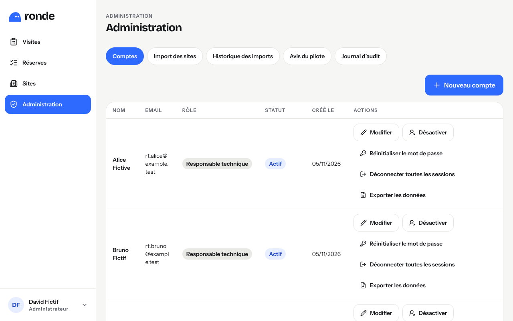
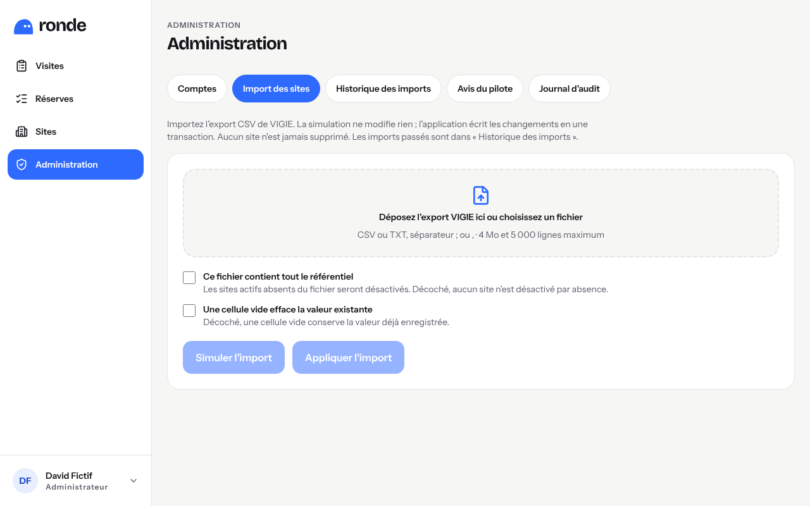
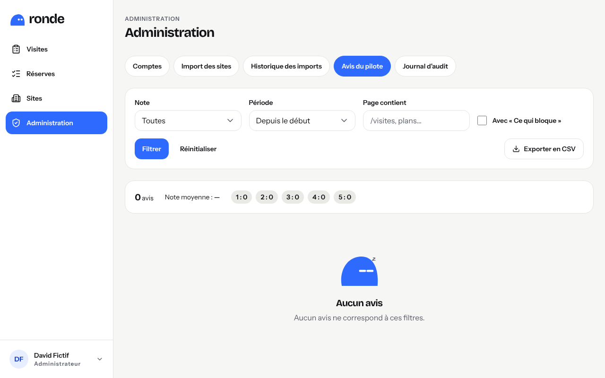
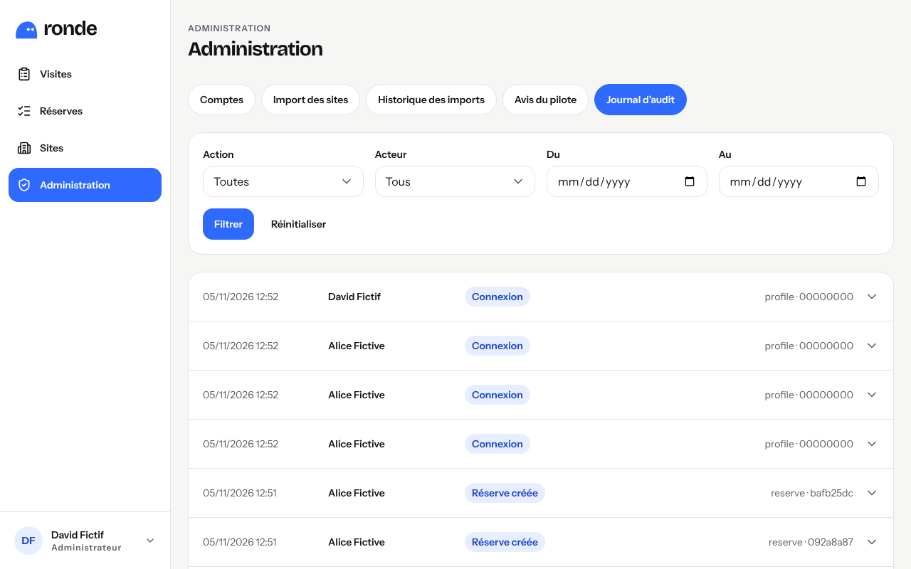

# Guide de l'administrateur

L'administrateur gère les comptes, le référentiel des sites (import VIGIE), lit les avis du
pilote et le journal d'audit. Tout se trouve dans **Administration**.

## Comptes

`/admin/comptes` liste tous les comptes, actifs en premier.

### Créer un compte

1. **« Nouveau compte »** : nom, e-mail professionnel, rôle (**RT**, **Direction** en lecture
   seule, **Admin**).
2. Le **mot de passe provisoire** s'affiche **une seule fois** : transmettez-le à la personne
   par un canal sûr (en main propre, téléphone). Il n'est conservé nulle part.
3. À sa première connexion, la personne choisit son propre mot de passe.

### Modifier, désactiver, réactiver

- **« Modifier »** : nom et rôle. Vous ne pouvez pas retirer votre propre rôle d'admin, ni
  désactiver le dernier admin actif.
- **« Désactiver »** : la personne est déconnectée à sa requête suivante et ne peut plus se
  connecter. Un compte ne se supprime jamais : son historique (visites, réserves, photos) reste
  attribué.
- **« Réactiver »** : la personne se reconnecte avec son mot de passe ; ses anciennes sessions
  restent coupées.

### Mot de passe oublié

**« Réinitialiser le mot de passe »** : un nouveau mot de passe provisoire s'affiche une fois ;
l'ancien cesse de fonctionner et **toutes les sessions sont déconnectées**.

### Déconnecter toutes les sessions (tablette perdue)

**« Déconnecter toutes les sessions »** coupe la session sur tous les appareils de la personne
(tablette, ordinateur) dès leur requête suivante. À utiliser en cas de perte ou de vol, puis
réinitialiser le mot de passe.

### Exporter les données d'un compte (RGPD)

**« Exporter les données »** télécharge un fichier JSON avec le profil, les visites créées ou
rédigées, les participations, les réserves et les photos du compte, et ses entrées du journal.
Aucune adresse e-mail d'une autre personne n'y figure. À remettre à la personne qui exerce son
droit d'accès.

### Anonymiser un compte (RGPD)

Pour un compte **déjà désactivé** seulement :

1. **« Anonymiser »**, lire l'avertissement, **« Continuer »** ;
2. saisir le **nom complet** du compte, exactement, puis **« Anonymiser définitivement »**.

Le nom devient « Compte anonymisé XXXXXX », l'e-mail est remplacé, la connexion est bloquée.
C'est **irréversible**. Les rapports PDF déjà produits gardent le nom (ils sont figés) : voir
`docs/rgpd.md`.

## Import des sites VIGIE

`/admin/sites/import` met à jour le référentiel à partir de l'export CSV de VIGIE. Les sites ne
se modifient jamais à la main.

1. Choisir le fichier CSV (séparateur `;` ou `,`, encodage UTF-8 ou Windows).
2. **« Simuler l'import »** : le bilan montre les sites créés, modifiés, réactivés, inchangés et
   les lignes rejetées, avec la raison. Rien n'est écrit.
3. Vérifier le bilan, puis **« Appliquer l'import »** et confirmer. L'import est appliqué en une
   fois (tout ou rien).
4. **« Ce fichier contient tout le référentiel »** désactive les sites actifs absents du
   fichier (décoché : aucun site n'est désactivé) ; une désactivation massive demande une
   confirmation explicite.

L'historique des imports (`/admin/sites/imports`) garde chaque simulation et chaque
application, avec l'empreinte du fichier.

## Avis du pilote

`/admin/avis` liste les avis donnés avec **« Donner mon avis »** : note de 1 à 5, « Ce qui
marche », « Ce qui bloque », page et taille d'écran, version de RONDE.

- **Filtres** : note (« 2 ou moins » pour les mécontents), période, page (« /visites »,
  « plans »), « Avec « Ce qui bloque » ».
- **« Exporter en CSV »** : le fichier s'ouvre dans Excel (séparateur `;`, accents conservés)
  et suit les filtres affichés.
- Conseil pour le pilote : un point hebdomadaire sur les avis notés 1 ou 2 et sur « Ce qui
  bloque ».

## Journal d'audit

`/admin/journal` trace les actions sensibles : connexions (et échecs, sans l'adresse e-mail en
clair), comptes, sessions déconnectées, imports, visites terminées ou rouvertes, réserves,
rapports, purges planifiées, exports et anonymisations. Filtres par action, auteur et période ;
chaque ligne se déplie pour voir le détail. Le journal ne se modifie jamais.

## À connaître

- **Purge nocturne** : chaque nuit, les envois abandonnés (photos, plans, rapports commencés
  mais jamais terminés depuis plus de 24 h) sont supprimés ; trace « Purge planifiée ».
- **E-mails des responsables externes** : effacés 24 mois après la levée de la réserve, par un
  script lancé par l'exploitation (`docs/rgpd.md`).
- Les guides sont disponibles dans l'application : menu du compte → **Aide**.
