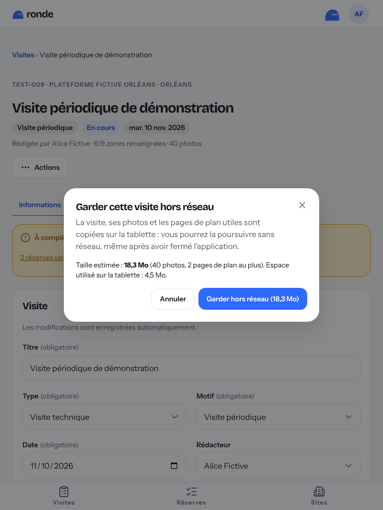
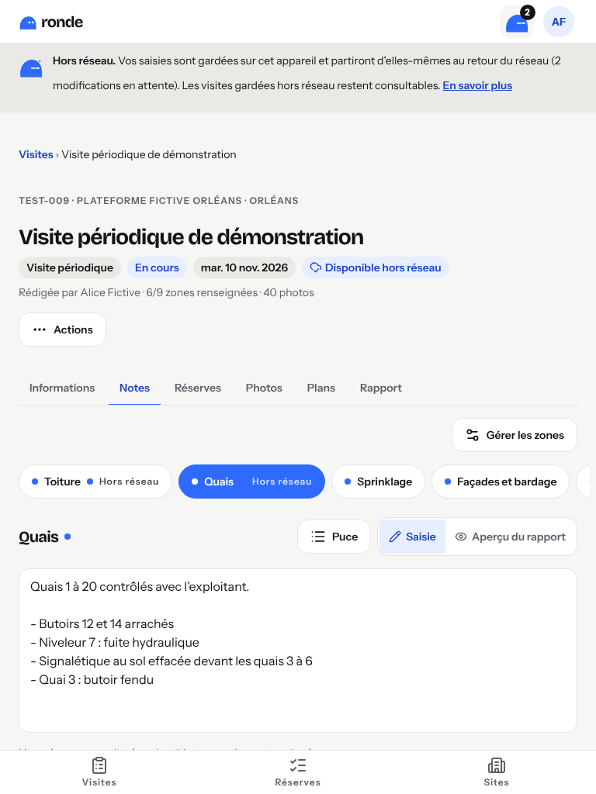
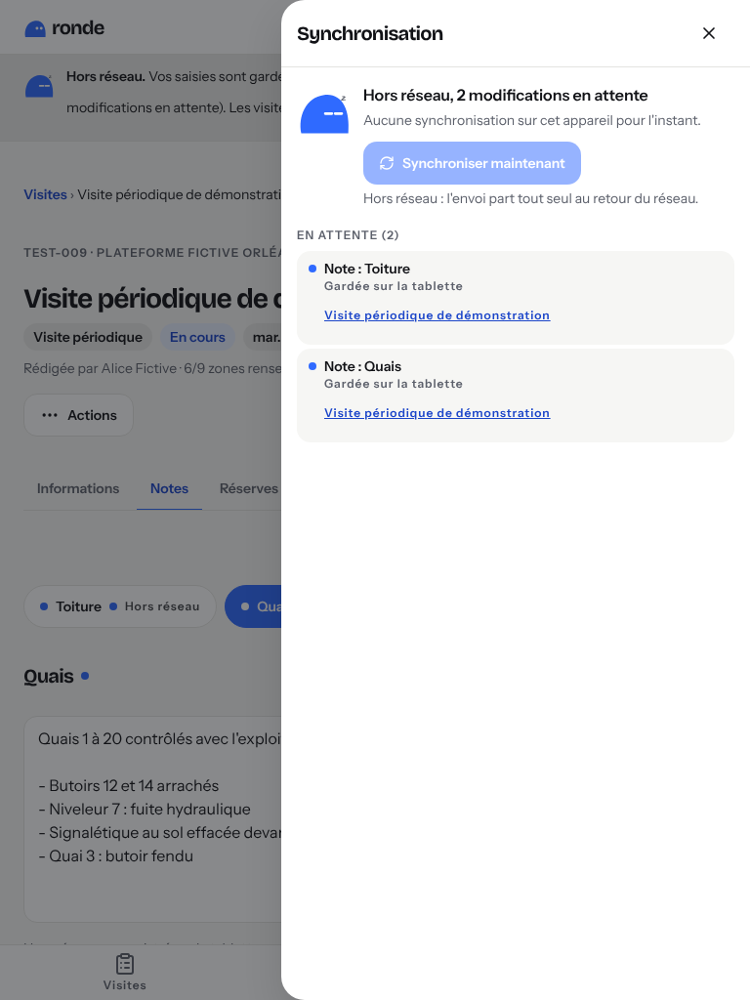
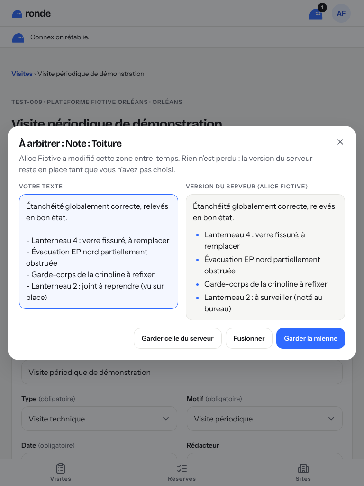

# Guide des RT

RONDE sert à préparer, mener et suivre vos visites de site, de la première note jusqu'à la
levée des réserves. Vous pouvez commencer une visite sur l'ordinateur, la poursuivre sur la
tablette pendant la tournée, puis la terminer au bureau : tout est enregistré au fur et à
mesure.

> **Pendant le pilote** : au moindre doute, ouvrez le menu du compte (vos initiales, en haut à
> droite sur la tablette) puis **« Donner mon avis »**. Chaque avis est lu.

## Installer RONDE sur la tablette

RONDE s'ouvre dans le navigateur. Installée sur l'écran d'accueil, elle s'ouvre en plein écran,
comme une application.

**iPad (Safari)**

1. Ouvrez RONDE dans Safari et connectez-vous.
2. Touchez le bouton **Partager** (le carré avec une flèche vers le haut).
3. Choisissez **« Sur l'écran d'accueil »**, puis **Ajouter**.

**Tablette Android (Chrome)**

1. Ouvrez RONDE dans Chrome et connectez-vous.
2. Touchez le menu **⋮** en haut à droite.
3. Choisissez **« Installer l'application »** (ou « Ajouter à l'écran d'accueil »).

L'icône bleue de RONDE apparaît alors sur l'écran d'accueil.

## Se connecter

Saisissez votre adresse e-mail professionnelle et votre mot de passe. À la première connexion,
RONDE vous demande de remplacer le mot de passe provisoire reçu de l'administrateur.

- **Mot de passe oublié** : demandez à l'administrateur de le réinitialiser ; vous recevrez un
  nouveau mot de passe provisoire.
- Votre session reste ouverte pendant la journée ; **« Se déconnecter »** est dans le menu du
  compte.

## Créer une visite

1. Sur **Visites**, touchez **« Nouvelle visite »**.
2. Choisissez le site : tapez son code (« TEST-013 »), son nom ou sa ville, sans vous soucier des
   accents.
3. Indiquez le type, le motif, la date et un titre, puis **« Créer la visite »**.

La liste **Mes visites** montre vos visites en cours et terminées, avec les points à compléter.

## Passer du PC à la tablette

Il n'y a rien à faire : ouvrez la même visite sur la tablette, tout ce qui a été saisi au bureau
y est. Les champs s'enregistrent tout seuls (« Enregistré à 10:42 »).

Si la même visite est modifiée en même temps sur deux appareils, RONDE l'indique et propose
**« Garder ma version »** ou de recharger : rien n'est perdu sans que vous l'ayez choisi.

## Pendant la visite

### Notes

L'onglet **Notes** propose une zone par partie du site (toiture, quais, sprinklage…). Écrivez
librement ; une ligne qui commence par « - » devient une puce. Une zone se renomme, s'ajoute ou
se retire (si elle est vide).

### Photos

Dans **Photos**, touchez **« Prendre une photo »** (appareil de la tablette) ou **« Importer des
photos »**.
Les photos sont réduites sur la tablette avant l'envoi, la position GPS est retirée. Choisissez
la **photo de garde** du rapport et rattachez chaque photo à une zone si besoin.

> **À éviter** : les visages et les plaques d'immatriculation. Cadrez sur l'installation.

### Plans

Dans **Plans**, ouvrez un plan du site, zoomez avec deux doigts, puis touchez **« Placer un
repère »** et touchez l'endroit voulu (un seul doigt). Un repère peut être relié à une réserve.

### Réserves

Dans **Réserves**, touchez **« Nouvelle réserve »** : l'action à mener suffit ; ajoutez si
possible la zone, la priorité, le responsable (interne ou entreprise extérieure), l'échéance et
une photo. Le filtre **« En retard uniquement »** montre ce qui presse.

## Terminer une visite

Quand tout est saisi, ouvrez **Actions** puis **« Terminer la visite »**. Une visite terminée
ne se modifie plus ; son auteur ou l'administrateur peut la rouvrir (Actions → **« Rouvrir »**). Les réserves continuent d'être
suivies jusqu'à leur levée, depuis le menu **Réserves**.

## Générer le rapport

Dans l'onglet **Rapport**, touchez **« Générer le rapport »**. Le PDF est fabriqué sur
l'appareil, téléchargé tout de suite et conservé dans l'historique de la visite, où il se
retélécharge à l'identique. Tant que la visite n'est pas terminée, le rapport porte la mention
**BROUILLON**.

- **Options** : rubriques, nombre de photos par page, qualité « Légère » pour un fichier plus
  petit (envoi par e-mail).
- Sur PC, **« Ouvrir l'aperçu »** l'affiche dans un nouvel onglet.

## Travailler sans réseau

Dans un entrepôt, le réseau va et vient. RONDE continue de fonctionner : **tout ce que vous
saisissez est enregistré sur la tablette**, puis envoyé tout seul dès que le réseau revient.

### Avant de partir : garder la visite sur la tablette

Ouvrez la visite **une fois avec le réseau** sur la tablette : elle est gardée
automatiquement, le badge **« Disponible hors réseau »** apparaît. Sur l'ordinateur, ou pour
une visite que vous n'avez pas encore ouverte, touchez **Actions → « Garder hors réseau »** :
RONDE indique la place nécessaire (photos et plans compris), puis télécharge la visite.

Une visite gardée s'ouvre ensuite **même sans réseau**, même après avoir fermé et rouvert
l'application. « Mes visites » montre alors les visites gardées sur la tablette.

### Le Galet vous dit où vous en êtes

En haut de l'écran, le Galet indique l'état de la synchronisation, avec le nombre de
modifications qui attendent :

| Galet    | Ce que cela veut dire                                                              |
| -------- | ---------------------------------------------------------------------------------- |
| endormi  | **hors réseau** : vos saisies sont gardées sur la tablette (le chiffre en attente) |
| attentif | **envoi en cours**                                                                 |
| souriant | **tout est à jour**, avec l'heure de la dernière synchronisation                   |
| inquiet  | **à regarder** : une modification est à arbitrer ou a été refusée                  |

Touchez le Galet pour voir **la liste des modifications en attente**, en phrases simples
(« Note : Toiture », « Réserve : Remplacer le lanterneau 2 »…), et **« Synchroniser
maintenant »**. Une petite pastille signale aussi, dans la visite, ce qui n'est pas encore
envoyé.

### Ce que vous pouvez faire sans réseau

Tout ce qui sert pendant la visite : informations, participants, **notes**, **photos**,
**repères** sur un plan déjà importé, **réserves** (création, modification, levée).

- Une réserve créée sans réseau s'affiche **« R-? »** : son numéro est donné au retour du
  réseau (deux tablettes ne peuvent pas prendre le même numéro).
- Un repère posé sans réseau s'affiche **« • »** jusqu'à l'envoi.

Demandent le réseau (le bouton est grisé et la raison affichée) : **créer une visite**,
**importer un plan**, **générer le rapport**, **terminer la visite** (et la rouvrir, la
dupliquer ou la supprimer).

### Au retour du réseau

Rien à faire : l'envoi part tout seul (au retour du réseau, au retour dans l'application, puis
toutes les 30 s s'il reste quelque chose). Le Galet redevient souriant quand tout est arrivé.

### « À arbitrer » : la même chose modifiée ailleurs

Si quelqu'un (ou vous, sur l'ordinateur) a modifié **la même note** ou **la même réserve**
pendant que vous étiez hors réseau, **rien n'est écrasé**. Le Galet devient inquiet ; touchez-le
puis **« Arbitrer »** :

- pour une note, les deux textes côte à côte : **« Garder la mienne »**, **« Garder celle du
  serveur »** ou **« Fusionner »** (un champ contient les deux textes, à arranger) ;
- pour une réserve ou les informations de la visite, choisissez champ par champ.

Si la visite a été **terminée** entre-temps (sur l'ordinateur, par exemple), votre
modification ne peut plus être enregistrée : elle reste dans la liste avec son texte et
**« Copier le texte »**, pour la reprendre ailleurs.

### À savoir

- **Se déconnecter efface la copie de la tablette.** Si des modifications n'ont pas été
  envoyées, RONDE vous prévient : synchronisez d'abord.
- Si votre session expire pendant que vous êtes hors réseau, vos saisies restent sur la
  tablette : reconnectez-vous, l'envoi reprend.
- Une copie qui n'a pas vu le réseau depuis **14 jours** est effacée.
- La place utilisée sur la tablette est indiquée dans le menu du compte.

## Ce qui change par rapport à CR Visites

| CR Visites                          | RONDE                                                              |
| ----------------------------------- | ------------------------------------------------------------------ |
| Saisie au bureau, après la visite   | Saisie sur la tablette pendant la visite, reprise au bureau        |
| Compte rendu Word à mettre en forme | Rapport PDF généré en un geste, conservé dans l'historique         |
| Photos copiées à la main            | Photos prises dans RONDE, réduites, rangées par zone               |
| Réserves dans le document           | Réserves suivies jusqu'à leur levée, avec échéance et responsable  |
| Plans à part                        | Plans du site avec repères placés au doigt                         |
| Liste des sites à saisir            | Référentiel VIGIE importé : on choisit le site, on ne le tape plus |

## Que faire si…

### Il n'y a pas de réseau

Continuez : vos saisies sont gardées sur la tablette et partiront seules (voir
**« Travailler sans réseau »**). Un bandeau le rappelle.

### RONDE annonce un conflit

Quelqu'un (ou vous-même, sur un autre appareil) a modifié la même chose entre-temps. Rien n'est
perdu : touchez le Galet puis **« Arbitrer »** (voir **« À arbitrer »** plus haut).

### Une photo ne part pas

Vérifiez le réseau, puis touchez **« Réessayer »** sur la photo. Si elle est refusée (format non
pris en charge, photo trop lourde), le message l'indique : reprenez la photo depuis RONDE.

### La tablette est perdue ou volée

Prévenez **tout de suite** l'administrateur : il déconnecte toutes vos sessions à distance
(« Déconnecter toutes les sessions ») et réinitialise votre mot de passe. La copie des visites
gardées sur la tablette est alors effacée dès qu'elle retrouve le réseau ; sans réseau, elle
l'est au bout de 14 jours. Le code de verrouillage de la tablette protège la copie entre-temps.

### Autre chose

Menu du compte → **« Donner mon avis »** : décrivez ce qui bloque, la page concernée est jointe
automatiquement.

