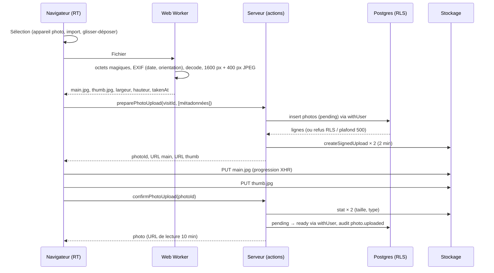

# Photos

L'onglet **Photos** d'une visite permet au RT de prendre des photos avec la tablette ou
d'importer des images, de les compresser dans le navigateur, de les envoyer **directement au
stockage** par URL signée, puis de les légender, les classer, les lier à une zone et choisir la
photo de garde. La direction consulte la galerie et la visionneuse sans aucun contrôle.

## Parcours d'envoi



1. **Sélection** (`PhotoPickerButtons`) : « Prendre une photo » (`<input type="file"
accept="image/*" capture="environment">`, en premier sur écran tactile) et « Importer des
   photos » (`multiple`, `accept="image/jpeg,image/png,image/webp"`) ; le glisser-déposer
   fonctionne sur PC (grille de l'onglet).
2. **Traitement dans le navigateur** (`src/lib/photos/process.ts`, exécuté dans un Web Worker
   avec `OffscreenCanvas` quand le navigateur le permet, sinon sur le fil principal) :
   octets magiques, date EXIF (`exifr`), décodage avec `createImageBitmap(…,
{ imageOrientation: "from-image" })`, redimensionnement à 1600 px et 400 px, encodage JPEG.
   Deux images au plus sont traitées en même temps (`createLimiter(2)`).
3. **Préparation** (`preparePhotoUploadAction` → `PhotoService.prepare`) : lignes `photos` en
   `pending` insérées **sous RLS** (`withUser`), `storage_path` `{visit_id}/{photo_id}.jpg`,
   `thumb_path` `{visit_id}/{photo_id}_thumb.jpg`, `mime_type` `image/jpeg`, dimensions,
   taille, nom d'origine assaini (`sanitizeFilename`), `taken_at`, `zone_key` optionnel,
   `sort_order` en fin de liste. Deux URL d'envoi signées par photo, valables 2 minutes.
   Refus : visite non modifiable (RLS), plus de 500 photos, taille au-dessus de 4 Mo.
4. **Envoi** (`src/lib/photos/put.ts`, `XMLHttpRequest` pour la progression) : trois photos en
   parallèle, nouvelles tentatives après 1 s, 3 s et 10 s sur erreur réseau ou 5xx ; sur 400,
   401, 403 ou 410 (URL expirée ou invalide), de nouvelles URL sont demandées pour la même
   photo (`renewPhotoUploadAction`).
5. **Confirmation** (`confirmPhotoUploadAction` → `PhotoService.confirm`) : `stat` des deux
   objets (présence, taille égale à la taille déclarée, type `image/jpeg`), passage en `ready`
   sous RLS, audit `photo.uploaded`. Si un objet manque, la photo reste `pending` (invisible)
   et le navigateur renvoie le fichier. Si la visite a été terminée entre-temps : « La visite
   est terminée : la photo n'a pas été ajoutée. »
6. **File d'envoi** (`UploadQueuePanel`, en bas de l'onglet Photos et sous les photos d'une
   zone dans Notes ; pastille « N envois en cours » dans l'en-tête) : miniature locale, état
   (« Préparation », « Envoi 45 % », « Vérification », « Terminé », « Échec : … »), barre de
   progression, « Réessayer », « Retirer », « Effacer les terminés ». `beforeunload` tant qu'un
   envoi est actif.

## Formats et compression

| Entrée                                             | Sortie                                                              |
| -------------------------------------------------- | ------------------------------------------------------------------- |
| JPEG, PNG, WebP (octets magiques, pas l'extension) | JPEG, qualité 0,8, 1600 px au plus grand côté                       |
| —                                                  | miniature JPEG, qualité 0,7, 400 px                                 |
| HEIC, GIF, PDF, texte renommé `.jpg`               | refus : « Format non pris en charge : utilisez JPEG, PNG ou WebP. » |

- L'orientation EXIF est appliquée **avant** le redimensionnement : une photo en orientation 6
  est affichée droite et ses dimensions stockées sont celles d'après la rotation.
- La transparence (PNG, WebP) devient blanche.
- Le fichier final doit faire 4 Mo au plus (garanti en pratique ; sinon « Image trop lourde
  après compression (4 Mo maximum) »). L'original n'est **jamais** envoyé.
- Mesures sur les images de test synthétiques (`pnpm fixtures:images`) :

  | Image                    | Entrée              | Image principale   | Miniature |
  | ------------------------ | ------------------- | ------------------ | --------- |
  | `exif-orientation-6.jpg` | 400 × 600, 16 Ko    | 600 × 400, 11 Ko   | ~4 Ko     |
  | `gradient.png`           | 1200 × 900, 65 Ko   | 1200 × 900, 23 Ko  | ~5 Ko     |
  | `shapes.webp`            | 900 × 900, 13 Ko    | 900 × 900, 24 Ko   | ~7 Ko     |
  | `large-4000x3000.jpg`    | 4000 × 3000, 396 Ko | 1600 × 1200, 48 Ko | ~9 Ko     |

  Des photos réelles de chantier (textures, bruit) donnent des fichiers plus lourds : comptez
  200 à 400 Ko pour l'image principale et 20 à 40 Ko pour la miniature.

## Suppression de l'EXIF (RGPD)

Le ré-encodage par le canvas produit un JPEG **sans aucune métadonnée** : la position GPS, le
modèle d'appareil et le numéro de série ne quittent jamais la tablette. Seule la date de prise
de vue (`DateTimeOriginal`) est lue avant, et stockée dans `taken_at` (à défaut, `null` : la
date d'ajout fait foi). Le test e2e relit le fichier envoyé et vérifie l'absence de toute balise
EXIF et GPS.

## Plafonds

- **500 photos par visite**, `pending` comprises (« Plafond de 500 photos par visite
  atteint. »), vérifié à la préparation sous un verrou par visite.
- 50 photos par appel de préparation (la file prépare photo par photo, dans l'ordre choisi).
- 3 envois en parallèle, 2 traitements en parallèle.
- Bucket `visit-photos` : 15 Mo par objet (limite Supabase), 4 Mo par la règle applicative.

## Purge des photos en attente

Une ligne `pending` dont l'envoi n'a jamais été confirmé n'apparaît nulle part (listes,
compteurs, `visit_summaries`, photo de garde). `private.purge_stale_pending_photos(interval)`
(migration 14, `service_role` seulement) supprime les lignes de plus de 24 h et renvoie leurs
chemins ; `purgeStalePendingPhotos` efface ensuite les objets. Elle est appelée au chargement
de l'onglet Photos, au plus une fois par minute et par processus ; une tâche planifiée la
remplacera à l'étape 11. Un objet dont la suppression échoue est consigné dans les logs et
repris par la purge.

## Catégories

`src/server/domain/photos.ts` : `general` Vue générale (défaut), `defect` Désordre, `equipment`
Équipement, `safety` Sécurité, `works` Travaux, `other` Autre. Une valeur inconnue en base est
affichée comme « Vue générale ».

## Photo de garde

Une seule par visite parmi les photos `ready` (index partiel). « Définir comme photo de garde »
retire l'ancienne et pose la nouvelle dans une transaction sérialisée par visite
(`pg_advisory_xact_lock`) : deux demandes simultanées donnent une seule photo de garde, sans
erreur. Le rapport PDF (étape 10) l'utilisera en couverture.

## Onglet Photos et visionneuse

- Filtres **zone** (zones de la visite, « Sans zone »), **catégorie**, **« Sans légende »**,
  compteur « 42 photos » (ou « 3 sur 42 photos » avec un filtre), tout dans l'URL
  (`?onglet=photos&zone=docks&categorie=defect&legende=sans&photo=<id>`).
- Grille 2 colonnes sous 640 px, 3 en tablette portrait, 4 à partir de 1024 px, 5 à partir de
  1536 px ; miniatures `` dans une boîte 4:3, pour
  éviter tout saut de mise en page ; légende tronquée ou « Sans légende » ; badge de zone ;
  étoile « Garde ».
- Visionneuse plein écran : image 1600 px, précédente / suivante (boutons de 52 px, flèches,
  balayage), Échap, zoom par pincement laissé au navigateur (`touch-action: pinch-zoom`).
  Panneau d'édition : légende (500 caractères, enregistrement 800 ms après la frappe), catégorie,
  zone, photo de garde, « Déplacer avant / après », « Supprimer » (dialog de confirmation).
  En lecture seule, les mêmes informations sans contrôle.
- Les URL signées expirent après 10 minutes : l'erreur de chargement d'une image demande des
  URL fraîches (`renewPhotoUrlsAction`), une fois par photo à la fois.
- Suppression : ligne via `withUser` (RLS), audit `photo.deleted`, puis `remove` des deux
  objets ; la visionneuse passe à la photo suivante.

## Liens avec les notes et les points incomplets

- Sous l'éditeur d'une zone : « N photos liées », « Ajouter une photo à cette zone » (prise de
  vue ou import avec `zone_key` prérempli) et une bande de miniatures qui ouvre la visionneuse
  de l'onglet Photos. La liste des zones affiche le nombre de photos de chaque zone.
- Le retrait d'une zone qui a des photos est refusé : « Déplacez ou retirez d'abord les
  N photos liées. »
- « N photos sans légende » dans l'encadré « À compléter » et le dialog « Terminer la
  visite », avec un lien vers l'onglet Photos filtré sur « Sans légende ». Jamais bloquant.
- Les cartes de visite et l'en-tête affichent le nombre de photos `ready`.

## File d'envoi : interface et persistance future (phase 2)

`createUploadQueue` (`src/lib/photos/queue.ts`) est indépendant de React et testé avec une
horloge simulée. Sa surface est le contrat d'une future file **persistante hors ligne** :

```ts
interface UploadQueue {
  enqueue(files: { file: Blob; name: string }[], options?: { zoneKey?: string | null }): void;
  onChange(listener: (items: UploadItem[]) => void): () => void;
  items(): UploadItem[];
  retry(localId: string): void;
  remove(localId: string): void;
  clearDone(): void;
  hasActive(): boolean;
  dispose(): void;
}
```

Les dépendances (`process`, `prepare`, `renew`, `put`, `confirm`, `discard`) sont injectées :
la phase 2 remplacera la mémoire par IndexedDB (fichiers traités + `photoId`) et rejouera
`prepare` / `put` / `confirm` au retour du réseau, sans toucher à l'interface. Rien n'est
écrit dans le stockage du navigateur à cette étape (voir `docs/decisions.md`).
