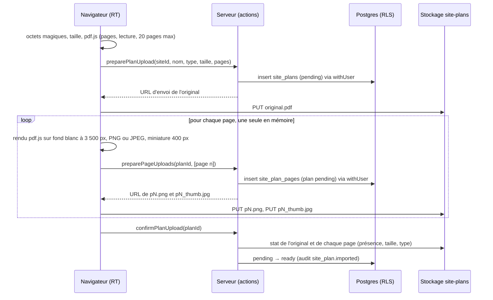

# Plans et repères

L'onglet **Plans** d'une visite et la section **Plans** de la fiche site permettent d'importer
l'export AutoCAD d'un entrepôt (PDF, PNG ou JPEG), puis d'y placer au doigt des **repères
numérotés** liés aux photos de la visite. La direction consulte plans et repères en lecture
seule.

## Pourquoi les plans sont rattachés au site

Un plan décrit le bâtiment, pas la visite : il est importé une fois sur le **site** et réutilisé
d'une visite à l'autre. Les repères, eux, appartiennent à la visite (`plan_markers.visit_id`).
C'est ce qui permettra, en phase 3, de comparer les photos d'un même endroit d'une visite à
l'autre (avant / après). Un plan n'est jamais supprimé : il s'archive.

## Import : conversion des pages en images dans le navigateur

- **Formats acceptés** : PDF (reconnu par `%PDF-` dans les 1 024 premiers octets), PNG, JPEG.
  Un faux PDF, un PDF protégé ou endommagé, un PDF de plus de **20 pages** ou un fichier de plus
  de **50 Mo** sont refusés **avant tout envoi**, avec un message.
- **Rendu** : `pdfjs-dist` 6.4.299 (version exacte). Son worker est empaqueté par Next.js à
  partir de `node_modules` et servi par l'application : aucune ressource n'est chargée depuis un
  CDN. L'analyse du PDF tourne dans ce worker ; le dessin de chaque page se fait sur un canvas,
  une page à la fois, sur fond blanc forcé (certains exports sont transparents).
- **Taille** : chaque page est dessinée à **3 500 px** sur son plus grand côté. Une image
  source plus grande est réduite à 3 500 px en gardant ses proportions ; une image plus petite
  n'est jamais agrandie. Si le rendu échoue (mémoire, canvas au-delà de la limite du
  navigateur), une nouvelle tentative a lieu à **2 500 px**, puis une erreur claire s'affiche.
- **Format** : les plans sont des dessins au trait, donc **PNG** tant que l'image fait au plus
  **8 Mo** ; au-delà (hachures denses, plan scanné), **JPEG qualité 0,9**. Miniature JPEG
  qualité 0,7, 400 px.
- **Original conservé** : le fichier importé est stocké tel quel (`original.pdf|png|jpg`) et
  reste téléchargeable depuis la visionneuse (« Télécharger l'original »).
- **Envoi** : même règle qu'à l'étape 7, aucune URL signée sans ligne créée sous RLS. `PUT`
  direct au stockage (`src/lib/upload/put.ts`, partagé avec les photos), nouvelles tentatives
  après 1 s, 3 s et 10 s, URL renouvelée si elle a expiré. « Annuler l'import » supprime la
  ligne en attente et ses objets ; une ligne abandonnée est purgée après 24 h.

Mesures sur les plans de test synthétiques (`pnpm fixtures:plans`), Chromium sur PC :

| Fichier               | Entrée                   | Pages converties                    | Miniatures | Durée de l'import |
| --------------------- | ------------------------ | ----------------------------------- | ---------- | ----------------- |
| `plan-a1-3-pages.pdf` | PDF vectoriel, 5 Ko      | 3 × PNG 3 500 × 2 471, 240 à 254 Ko | 10 à 11 Ko | 2,9 s à 3,7 s     |
| `plan-5000x3500.png`  | PNG 5 000 × 3 500, 71 Ko | 1 × PNG 3 500 × 2 450, 169 Ko       | 10 Ko      | 1,0 s             |

Un vrai plan AutoCAD dense donnera des PNG de 1 à 6 Mo par page ; au-delà de 8 Mo la page
passe en JPEG.

## Coordonnées relatives et numérotation stable

- Un repère est stocké en **coordonnées relatives** (`x`, `y` entre 0 et 1) à l'image de sa
  page, avec 5 décimales (`numeric(6,5)`) : la position ne dépend ni de la résolution
  d'affichage ni du niveau de zoom, et le rapport PDF (étape 10) la reportera sur l'image.
  Les bords exacts (0 et 1) sont acceptés ; en dehors, le placement est refusé.
- `number` est attribué par le trigger `plan_markers_before_insert` à partir du compteur
  `plan_marker_counters (visit_id, plan_id, last_number)` (migration 17), incrémenté par
  `insert … on conflict do update … returning` : le verrou de ligne de l'upsert sérialise deux RT
  qui placent un repère en même temps. **Un numéro n'est jamais réattribué**, même celui du
  dernier repère supprimé (avant la migration 17, « plus grand numéro + 1 » le rendait) ; les
  trous sont normaux, et le numéro d'un repère ne change jamais. Les libellés, les légendes et le rapport s'y réfèrent : renuméroter ferait
  mentir des documents déjà diffusés.
- La base vérifie (trigger `plan_markers_check`) que la page existe, que la photo liée est de
  la même visite, que le plan est celui du site de la visite, prêt, et non archivé pour un
  nouveau repère.

## Visionneuse, placement et déplacement au doigt

- Zoom et déplacement écrits avec les **Pointer Events** (`src/components/plans/plan-canvas.tsx`,
  géométrie pure et testée dans `src/lib/plans/geometry.ts`) : molette et glisser à la souris,
  pincement et glisser à un doigt sur tablette, boutons « + », « − » et « Ajuster ».
- **Seul un toucher bref et immobile** (un seul pointeur, moins de 10 px de déplacement, moins
  de 600 ms) place ou déplace un repère. Un pincement, même s'il commence par un doigt, ne pose
  jamais de repère ; hors du mode « Placer un repère », un toucher n'en pose jamais.
- Les repères sont des **mini-galets** de 36 px, dessinés hors du calque zoomé : ils gardent la
  même taille à tous les niveaux de zoom, leur pointe désigne la position exacte. Un repère sans
  photo est dessiné en contour. Zone tactile de 44 px.
- **Feuille du repère** (panneau latéral à partir de 1 024 px, panneau du bas en dessous) :
  libellé (80 caractères, enregistré automatiquement), photo liée choisie parmi les photos de la
  visite (filtre par zone) ou **prise sur le moment** (file d'envoi de l'étape 7 : la photo est
  liée dès sa confirmation), « Retirer la photo », « Déplacer » (le prochain toucher sur le plan
  donne la nouvelle position ; glisser à la souris possible sur PC), « Supprimer le repère »
  avec confirmation.
- La liste des repères sous le plan centre la vue sur un repère ; un lien depuis la visionneuse
  photo (`?onglet=plans&plan=…&page=…&repere=…`) ouvre le plan centré sur le repère.
- **Lecture seule** (direction, RT non concerné, visite terminée) : zoom et consultation des
  repères, sans placement ni modification.

## Archivage

« Archiver » (RT, admin, avec confirmation) retire le plan des plans proposés pour de nouveaux
repères. Les visites qui y ont déjà des repères le montrent toujours, avec le badge
« Archivé » ; leurs repères restent modifiables (libellé, photo, position). « Désarchiver »
le rend de nouveau disponible. Renommage, archivage et désarchivage sont tracés dans le journal
d'audit.

## Liens avec les photos et les points incomplets

- Badge « R3 » sur la miniature d'une photo liée à un repère, mention « Repère n° 3 sur
  {plan} » dans la visionneuse avec un lien vers le plan.
- Supprimer une photo liée laisse le repère, sans photo (`on delete set null`) ; le dialog de
  suppression le signale.
- « N repères sans photo » dans l'encadré « À compléter » et dans le dialog « Terminer la
  visite », sans bloquer.

## Ce qui viendra

- **Étape 9** : une réserve pourra être placée sur le plan. `MarkerRepository` et la feuille du
  repère sont les points d'extension (commentés), aucune colonne n'est créée à cette étape.
- **Étape 10** : le rapport PDF affichera les images de pages avec leurs repères numérotés.
- **Phase 3** : comparaison avant / après des photos d'un même repère, d'une visite à l'autre.
