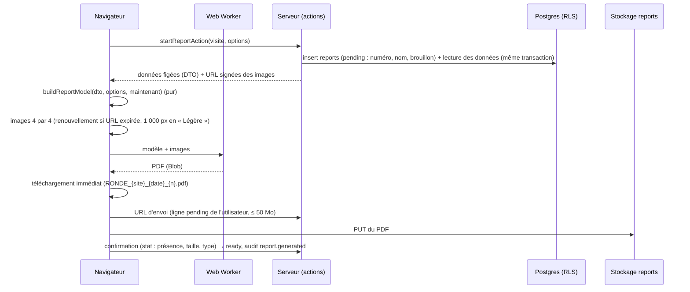

# Rapport PDF

L'onglet **Rapport** d'une visite produit le compte rendu de visite en PDF, **dans le
navigateur**, le télécharge aussitôt et le **conserve** dans le stockage (bucket `reports`)
avec son historique. Un RT, un admin ou un membre de la direction peut le générer (toute
personne active qui peut lire la visite) ; un compte désactivé ne le peut pas.

## Parcours de génération

- **Progression** : « Préparation des données… », « Chargement des photos 12 sur 40 », « Mise
  en page… », « Enregistrement… ». **Annuler** est possible jusqu'à l'enregistrement.
- **Échec de l'enregistrement** : le fichier déjà téléchargé reste valable ; le message le dit et
  propose « Réessayer l'enregistrement ».
- **Onglet fermé pendant la génération** : la ligne `pending` est purgée après 24 h
  (`private.purge_stale_pending_reports`, appelée au plus une fois par minute par le service, en
  attendant la tâche planifiée de l'étape 11).
- **Aperçu** : sur PC (1024 px et plus), « Ouvrir l'aperçu » ouvre le fichier dans un nouvel
  onglet ; sur tablette, le fichier est seulement téléchargé.

## Structure du rapport (A4 portrait, marges 18 mm)

| Section        | Contenu                                                                                                                                                                                                                                                                                                                                                                                                                                                                                                        |
| -------------- | -------------------------------------------------------------------------------------------------------------------------------------------------------------------------------------------------------------------------------------------------------------------------------------------------------------------------------------------------------------------------------------------------------------------------------------------------------------------------------------------------------------- |
| Couverture     | Logo, « Compte rendu de visite », site (code, nom, adresse), date, motif, rédacteur, photo de garde recadrée (sinon le galet `happy` sur fond pâle), pastilles « N réserves ouvertes · N en retard · N levées », trait « Boucle ». Toujours imprimée.                                                                                                                                                                                                                                                          |
| Synthèse       | Informations de la visite, participants (nom, entreprise, fonction, présence), **points clés** (réserves urgentes et en retard, 8 au plus), zones visitées. Sans réserve : « Aucune réserve relevée lors de cette visite » y figure.                                                                                                                                                                                                                                                                           |
| Réserves       | Tableau code, zone, action, priorité, responsable, échéance, statut. En-tête répété, ligne jamais coupée ; en retard : marque rouge **et** « En retard de N j » ; références « Fig. 12 » et « Plan A, R-07 ». Levées seulement si l'option est cochée.                                                                                                                                                                                                                                                         |
| Notes par zone | Une section par zone renseignée (paragraphes et puces de `parseNoteContent`), rappel court des réserves de la zone, grille de photos (2, 4 ou 6 par page) avec numéro de figure et légende ; une photo n'est jamais coupée. « Hors zone » en dernier.                                                                                                                                                                                                                                                          |
| Plans          | Dans l'ordre du site (étape 12 b) : la **vue extérieure** avec les contours des bâtiments, puis chaque bâtiment avec ses étages du bas vers le haut, titrés « Bâtiment B · R+1 » ; une page de plan non affectée garde « Plan A ». Une page par vue portant des repères de la visite (plans archivés compris), en paysage si l'image est plus large que haute ; repères vectoriels (mini-galets, pins carrés « R-07 », notes jaunes, mêmes formes et couleurs qu'à l'écran) ; légende avec le texte des notes. |
| Annexe photos  | Photos rattachées ni à une zone, ni à une réserve, ni à un repère.                                                                                                                                                                                                                                                                                                                                                                                                                                             |
| Pied de page   | Sur chaque page sauf la couverture : « {code site} · Visite du {date} », « Page X sur Y », « Généré par RONDE le {date et heure} par {nom} » ; en-tête : filet bleu et nom de la section.                                                                                                                                                                                                                                                                                                                      |

La vue extérieure est imprimée dès que la visite a des repères et qu'un contour y est tracé,
même sans repère sur elle. Les photos « À ranger » laissées sans emplacement (ni zone, ni
réserve, ni repère) vont en annexe. Une section vide n'est pas imprimée (sauf les réserves, voir
ci-dessus). Une visite sans photo,
réserve, plan ni note donne un PDF de **2 pages** (couverture et synthèse).

## Options

Choisies dans la feuille « Options », mémorisées dans `reports.options` (la génération suivante
reprend celles du dernier rapport de la visite) :

- rubriques : synthèse, réserves, notes, plans, annexe photos (la couverture est toujours là) ;
- « Inclure les réserves levées » (désactivé par défaut) ;
- photos par page : 2, 4 (par défaut) ou 6 ;
- qualité : « Standard » (photos de 1 600 px) ou « Légère » (réduites à 1 000 px par canvas,
  JPEG 0,78) ; les pages de plan gardent leur résolution ;
- photo de garde : celle de la visite, ou une autre photo.

## Brouillon et version finale

Une visite **en cours** donne un rapport **brouillon** : bandeau « BROUILLON : visite non
terminée » sur la couverture et filigrane léger sur toutes les pages ; `reports.is_draft` est
posé par la base à l'insertion et l'historique affiche le badge « Brouillon ». Une fois la visite
terminée, le rapport suivant est la version finale.

## Données incluses et exclues

- **Une seule lecture serveur** : `getReportData(visitId)` (et `startReport`, qui réserve la
  ligne dans la même transaction) renvoie un DTO typé, sous RLS (`withUser`) ; le rendu ne fait
  aucune autre requête que les images.
- **Exclus** : les **e-mails** (participants, responsables externes) ne sont jamais lus pour le
  rapport, qui est diffusé aux exploitants et prestataires ; le responsable figure par son nom et
  son entreprise. Photos `pending`, réserves supprimées.
- **Caractères** : accents, « œ », « € » conservés ; les symboles absents des polices sont
  écrits en toutes lettres (« ≥ » → « >= », « m² » → « m2 ») et les emoji retirés
  (`pdfText`).
- **Dates** en Europe/Paris, au format « 5 novembre 2026 ».

## Conservation et historique

- Chemin `{visit_id}/{report_id}.pdf` dans le bucket `reports` ; nom de téléchargement
  `RONDE_{code site}_{AAAA-MM-JJ}_{n}.pdf`, `n` étant le rang du rapport dans la visite, attribué
  par la base sous verrou (deux générations simultanées ont des numéros distincts).
- Un rapport n'est **jamais modifié ni supprimé** : seule la transition `pending` → `ready` par
  son auteur est permise, puis il est figé (trigger).
- Historique : date, auteur, pages, taille, badge « Brouillon », options résumées, «
  Télécharger » par la route `/visites/{id}/rapports/{reportId}` (droit vérifié sous RLS, puis
  redirection vers une URL signée de 10 minutes, enregistrée sous le nom du fichier).
- « Dernier rapport » figure sur les cartes de visite et sur la fiche du site
  (`visit_summaries.last_report_id`).

## Limites de taille

| Visite de démonstration (40 photos de 1 600 px, ~320 Ko chacune, 2 pages de plan) | Taille  | Pages |
| --------------------------------------------------------------------------------- | ------- | ----- |
| Standard                                                                          | 12,8 Mo | 21    |
| Légère                                                                            | 3,4 Mo  | 21    |
| Visite vide                                                                       | 24 Ko   | 2     |

Au-delà de **50 Mo** (limite du bucket), le fichier reste téléchargé sur l'appareil mais n'est
pas conservé ; le message propose la qualité « Légère ». Le PDF ne transite jamais par le
serveur (règle des 4 Mo).

## Code

| Élément                                   | Rôle                                                                                  |
| ----------------------------------------- | ------------------------------------------------------------------------------------- |
| `src/lib/report/types.ts`                 | DTO `ReportData` (aucun e-mail)                                                       |
| `src/lib/report/model.ts`                 | `buildReportModel` (pur), `pdfText`, dates, nom du fichier                            |
| `src/lib/report/options.ts`               | options (zod), valeurs par défaut, résumé                                             |
| `src/lib/report/layout.ts`                | géométrie : A4, marges, grilles de photos, plans en paysage, position des repères     |
| `src/lib/report/theme.ts`                 | couleurs (tokens de `globals.css`), polices, tailles                                  |
| `src/lib/report/pdf/document.tsx`         | composants `@react-pdf/renderer` (sections)                                           |
| `src/lib/report/pdf/report.worker.tsx`    | mise en page dans un Web Worker                                                       |
| `src/lib/report/images.ts`, `generate.ts` | chargement des images, orchestration, téléchargement, enregistrement                  |
| `src/server/reports/`                     | dépôt (réservation, lecture, confirmation, historique), service (URL signées, `stat`) |
| `public/fonts/report/`                    | Bricolage Grotesque et Instrument Sans (TTF, licence OFL)                             |

## Ajouter une section

1. Ajouter sa clé dans `REPORT_SECTIONS` et son libellé (`src/lib/report/options.ts`).
2. Calculer ses données dans `buildReportModel` (fonction pure, testée) et l'exposer dans
   `ReportModel` (`null` quand elle est vide ou désactivée).
3. Écrire son composant dans `document.tsx` avec `SectionPage` (en-tête et pied de page) ;
   aucun calcul dans le composant.
4. Ajouter un test de modèle et un test de rendu (texte extrait par pdf.js).

## Ce qui viendra

- **Étape 13** : photo de preuve de levée (`reserve_photos.kind = 'proof'`) dans le tableau et
  une section dédiée.
- **Étape 16** : envoi du rapport par e-mail.
- **Étape 18** : publication vers VIGIE.
- **Étape 11** : purge planifiée, `next/font/local` à partir des mêmes fichiers TTF.
