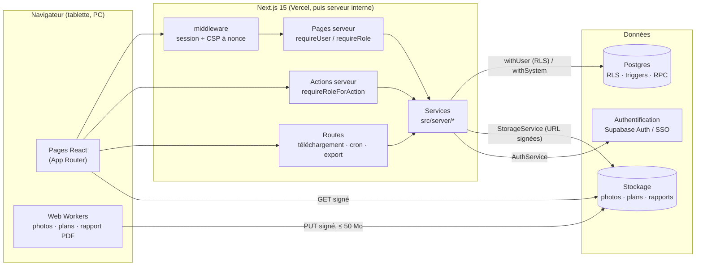

# Reprendre RONDE

Ce document permet à un développeur qui découvre RONDE de le comprendre, le lancer, le tester et
le déployer. Il complète `README.md` et `CLAUDE.md`.

## Architecture en une page



- Les **règles d'accès** sont dans la base (RLS, triggers, fonctions) : l'application ne les
  duplique que pour l'ergonomie.
- Les **fichiers** ne passent jamais par le serveur : le navigateur les envoie et les lit par
  des URL signées, délivrées après une vérification sous RLS.
- Le **rapport PDF** est fabriqué dans le navigateur (Web Worker), à partir d'une seule lecture
  serveur.

## Où se trouve quoi

| Dossier                   | Contenu                                                                                                         |
| ------------------------- | --------------------------------------------------------------------------------------------------------------- |
| `src/app/`                | pages et routes (App Router) ; `(app)/` = espace connecté, `(auth)/` = connexion                                |
| `src/components/`         | écrans par domaine (`visits/`, `reserves/`, `report/`, `admin/`…) et primitives `ui/`                           |
| `src/lib/`                | code pur partagé navigateur et serveur : formats, schémas zod, modèle du rapport, images                        |
| `src/server/`             | tout ce qui touche aux données : `db/`, `auth/`, `storage/`, dépôts, services, actions                          |
| `supabase/migrations/`    | schéma, RLS, triggers (une migration ne se modifie jamais)                                                      |
| `supabase/tests/`         | tests de la base (droits par rôle, audit RLS, triggers)                                                         |
| `tests/`                  | tests Vitest (unitaires et d'intégration)                                                                       |
| `e2e/`, `e2e/acceptance/` | tests Playwright ; recette des 6 critères du cahier des charges                                                 |
| `scripts/`                | base locale (`db/`), images de test (`fixtures/`), icônes (`brand/`), captures (`docs/`), exploitation (`ops/`) |
| `docs/`                   | une page par sujet ; commencer par `decisions.md`, `data-model.md`, `security.md`                               |

## Lancer, tester, déployer

Prérequis : Node 22, pnpm 10, PostgreSQL 16 local (base `ronde_test`).

```bash
pnpm install
pnpm db:reset          # crée ronde_test : émulation Supabase, migrations, seed fictive
cp .env.example .env.local   # fournisseurs local (voir les commentaires du fichier)
pnpm dev               # http://localhost:3000 — comptes fictifs, mot de passe Ronde-test-2026
```

| Commande               | Ce qu'elle vérifie                                              |
| ---------------------- | --------------------------------------------------------------- |
| `pnpm verify`          | lint, format, types, tests unitaires, build                     |
| `pnpm test:db`         | base : droits, triggers, audit RLS, services d'intégration      |
| `pnpm test:e2e`        | parcours Playwright sur un build de production (CSP surveillée) |
| `pnpm test:acceptance` | les 6 critères du cahier des charges, rapport HTML              |
| `pnpm test:contract`   | contrats `supabase` contre le projet de **test** (Léandre)      |

**Déployer** : pousser une branche crée une prévisualisation Vercel (projet Supabase de test) ;
fusionner dans `main` déploie la production. Les migrations distantes sont appliquées à la main
(`docs/deploy.md`) ; la mise en production initiale suit `docs/go-live.md`.

## Les règles de `CLAUDE.md`, expliquées

`CLAUDE.md` est écrit pour l'assistant de développement, mais chaque règle a une raison :

| Règle (n°)                                             | Pourquoi                                                                                    |
| ------------------------------------------------------ | ------------------------------------------------------------------------------------------- |
| Jamais d'action sur un environnement distant           | une erreur en production ne se rattrape pas ; seul Léandre applique migrations et scripts   |
| Couleurs par tokens seulement (1, 2)                   | une seule source de vérité visuelle ; un statut se lit aussi par son texte (accessibilité)  |
| Zones tactiles de 44 px (3)                            | saisie au doigt, avec des gants parfois, sur une tablette                                   |
| Textes en français, code en anglais (4)                | utilisateurs francophones, code lisible par tout développeur                                |
| Pas de Supabase hors `src/server/` (5, 14)             | la V2 remplace Supabase : une seule couche à réécrire                                       |
| Aucune donnée réelle ni secret dans le dépôt (6, 13)   | le dépôt peut être lu par d'autres ; gitleaks le vérifie en CI                              |
| Commit après chaque point, tests verts (7, 9)          | historique lisible, jamais de version cassée sur la branche                                 |
| Ne jamais modifier une migration (8)                   | une migration déjà appliquée en production ne se rejoue pas : on en écrit une nouvelle      |
| `requireUser` / `requireRole` partout (17)             | le middleware ne fait que rediriger ; la vérification réelle est dans chaque page et action |
| `withUser` / `withSystem` (18)                         | toute lecture passe par la RLS, sauf les services qui le justifient par un motif journalisé |
| Jamais `getSession()` pour un droit (19)               | un cookie peut être forgé : l'identité est vérifiée puis le profil relu à chaque requête    |
| Pas d'e-mail ni de mot de passe dans les journaux (20) | données personnelles et secrets ; le logger masque, l'audit hache                           |
| Un compte ne se supprime pas (22)                      | l'historique (qui a fait quoi) doit rester attribué ; l'anonymisation répond au RGPD        |
| Fichiers hors serveur, ≤ 4 Mo par requête (24)         | limite de Vercel ; les photos et PDF vont directement au stockage                           |
| Concurrence optimiste par `version` (25, 27, 30)       | PC et tablette modifient la même visite : on détecte le conflit au lieu d'écraser           |
| Journaux en ajout seul (26)                            | traçabilité : personne, même l'admin, ne réécrit l'historique                               |
| URL signées après lecture sous RLS (28)                | un lien vers une photo ne doit jamais contourner les droits                                 |
| Rapport dans le navigateur, figé (31)                  | pas de serveur de rendu à maintenir ; un rapport diffusé ne change plus                     |
| CSP à nonce, logger, audit RLS (32)                    | défense en profondeur ; les tests échouent si une règle est contournée                      |
| Scripts d'exploitation gardés (33)                     | un script ne peut pas viser la mauvaise base ni écrire sans confirmation                    |

## Pour aller plus loin

- `docs/decisions.md` : chaque choix d'architecture et sa raison.
- `docs/data-model.md` : tables, relations, droits par rôle.
- `docs/security.md`, `docs/rgpd.md`, `docs/cron.md`, `docs/pwa.md`.
- `docs/migration-serveur-interne.md` : la V2.
